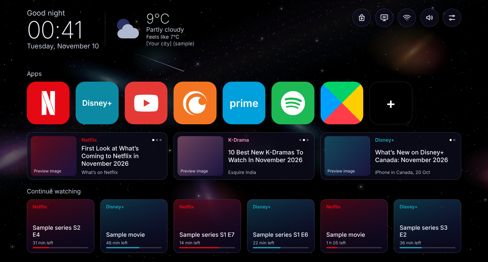

<h1 align="center">Stardrift TV Launcher</h1>

<p align="center">
A calm, ad free home screen for Google TV.<br>
A slowly drifting night sky, your apps, your news, your shows. Nothing else.
</p>

<p align="center">
  
  
  
</p>



*Design mockup with sample content. The real launcher is built to match it.*

## What it is

Stardrift replaces the Google TV home screen with something quieter. The background is a black sky that drifts left to right (one full turn in 20 minutes), with galaxies, coloured stars, a rare satellite and a quiet nova. On top of it you get a greeting, the clock, the weather, your app dock, a row of news picks and a Continue watching row.

No ads, no suggestions, no sponsored items, no tracking. Only what you pick shows on Home.

Made for Google TV and Android TV devices.

## Features

- Greeting with your name, clock, date, weather (city chosen by name search, no IP lookup)
- App dock: reorder, add, remove, hide, All apps list, and an optional icon look (Original, Black, White) that only works on some apps: it depends on how each app draws its icon, and many apps keep their original look
- Home rows: show, hide and reorder Apps, Picks and Continue watching from Settings
- Picks row: news from RSS feeds with preview images (anime, games, and more), feeds editable on the TV or added from your phone
- New series row and Continue watching row (reads the Google TV rows when your apps share them, otherwise your recently opened apps)
- Settings, Network (with a speed test), Inputs and Sound popups under the top icons
- Ambient home music and soft interface sounds, each with its own switch and volume
- Stardrift screensaver: same sky, 24 hour clock, date, Wi-Fi icon
- Quick actions: close background apps, clear cache

How to use all of it: [docs/MANUAL.md](docs/MANUAL.md)

## Get it on your TV

There is no ready made APK in this repository. You build your own, so it is signed with **your** key (a TV only accepts an update signed with the same key as the installed version). GitHub builds it for you, you do not need Android Studio.

1. **Fork** this repository (or use it as a template).
2. **Create a keystore** (your signing key) and add two secrets to your fork: `KEYSTORE_B64` and `KEYSTORE_PASSWORD`.
3. **Run the build**: Actions tab, *Build APK*, *Run workflow*. When it is green, download `tvlauncher.apk` from the *Releases* page of your fork (the `latest` release).
4. **Install it on the TV** with ADB.

Full steps with every command: [docs/BUILD.md](docs/BUILD.md)

Install in short (replace the address with your TV's):

```
adb connect TV_IP:PORT
adb -s TV_IP:PORT install -r tvlauncher.apk
adb -s TV_IP:PORT shell am start -n dev.tvlauncher.home/.MainActivity
```

New to ADB, or something does not connect: [docs/ADB.md](docs/ADB.md)

## Network (DNS filters)

If your network filters DNS (an ad blocker, for example), allow these hosts so the launcher works:

- `api.open-meteo.com` and `geocoding-api.open-meteo.com` (weather)
- the hosts of the feeds you switch on (see the table below) and the image hosts those feeds use

| Feed | URL |
|---|---|
| Crunchyroll News | `https://cr-news-api-service.prd.crunchyrollsvc.com/v1/en-US/rss` |
| MyAnimeList News | `https://myanimelist.net/rss/news.xml` |
| Nintendo Life | `https://www.nintendolife.com/feeds/latest` |
| Xbox Wire | `https://news.xbox.com/en-us/feed/` |
| PlayStation Blog | `https://blog.playstation.com/feed/` |
| Steam new releases | `https://store.steampowered.com/feeds/newreleases.xml` |

Steam new releases is off by default (its updates are irregular); the others are on. Feeds were checked on 6 Nov 2026. Feeds change; a feed that stops working can be replaced with Edit sources on the TV.

## Notes

- **Govee lights:** there is no custom light control. Lights open through the Govee app tile in the dock.
- **Privacy:** the launcher only talks to the weather service and to the feeds and images you enabled. Add feeds from your phone is a small web page on your home network, protected by a PIN, and only runs while that screen is open on the TV.
- **Building locally** (without GitHub) is not documented here. The GitHub Actions workflow is the tested way to build.

## Credits

- Weather data by [Open-Meteo](https://open-meteo.com/) (CC BY 4.0)
- The ambient song and the interface sounds were made for this project and are part of it, under the same license

## Not affiliated

Stardrift is an independent hobby project. It is not affiliated with, endorsed by or sponsored by Google, Netflix, Disney, Amazon, Crunchyroll, Spotify, YouTube, Govee, Nintendo, Microsoft, Sony Interactive Entertainment, Valve or any other company named here or shown in the mockup. Google TV, Android TV, Google Play, Netflix, Disney+, Prime Video, Crunchyroll, Spotify, YouTube, Govee and all other names and logos are trademarks of their owners and are used only to say which apps and services the launcher works with. App icons on your TV come from the apps you installed. News and images in the feeds belong to their publishers.

## License

Copyright (C) 2026 SpeakingColors

Stardrift TV Launcher is free software: you can redistribute it and modify it under the terms of the [GNU General Public License version 3](LICENSE). It is distributed without any warranty. If you share a modified version, share its source under the same license.
