# Stardrift manual

How the launcher works and how to use it. Everything is done with the TV remote: arrows move, **OK** opens, **Back** goes back. "Press and hold" means hold OK on the item.

The pictures are screenshots of the [interactive mockup](mockup/index.html), which uses sample content. Your TV shows your own apps and feeds.

## Contents

- [Making it your home screen](#making-it-your-home-screen)
- [The home screen](#the-home-screen)
- [Name and weather](#name-and-weather)
- [Apps (the dock)](#apps-the-dock)
- [Home rows: show, hide, order](#home-rows-show-hide-order)
- [Picks and New series](#picks-and-new-series)
- [Continue watching](#continue-watching)
- [Top icons](#top-icons)
- [Sound](#sound)
- [Screensaver](#screensaver)
- [Adding feeds from your phone](#adding-feeds-from-your-phone)
- [Privacy and network](#privacy-and-network)
- [Updating and removing](#updating-and-removing)
- [Problems](#problems)

## Making it your home screen

After you install it ([ADB.md](ADB.md)), Stardrift appears in the TV's app list as **Stardrift**. Opening it from there is a good way to try it first.

The app declares itself as a Home app, so Android can use it when you press the Home button. How the TV lets you choose it as the default differs between TVs and software versions: some ask which Home app to use the next time you press Home, others hide the choice in system settings. On many Google TVs the Home button keeps opening Google's own home screen; the way that worked for us, how to undo it, and how to find out why a remote button stops working are in [HOME.md](HOME.md).

To go back to the original Home screen, uninstall Stardrift (see [Updating and removing](#updating-and-removing)).

## The home screen

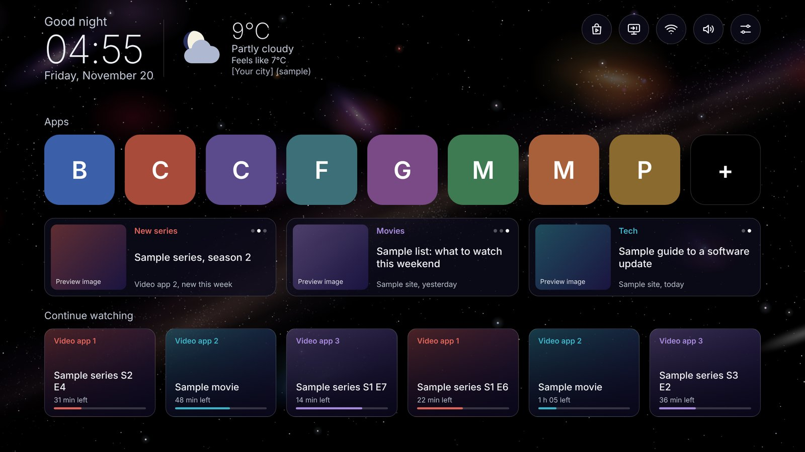
*The home screen: greeting, clock, weather, top icons, dock, news cards, Continue watching*

From top to bottom:

1. **Greeting, clock, date** and the **weather** block, with the **top icons** on the right
2. **Apps**: your dock
3. **Picks / New series**: a row of news cards (three dots show which page you are on)
4. **Continue watching**: cards for what you were watching

The background is a night sky that drifts slowly; it is only decoration and costs no attention.

## Name and weather

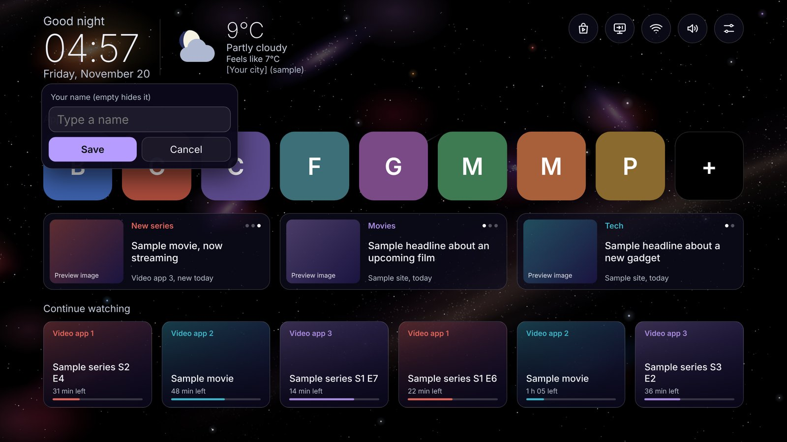
*Press OK on the clock to type a name*

- **Clock:** press OK on the clock to type a name for the greeting ("Good morning, Name"). Leave it empty for just "Good morning".
- **Weather:** the first time it says *Choose your city*, *Press OK here*. Type a city name and press Search on the keyboard, then pick it from the list. The city is chosen by name; nothing looks up your location. Press OK on the weather block later to change the city.

The weather comes from [Open-Meteo](https://open-meteo.com/). If it says *Weather unavailable*, check the network (see [Privacy and network](#privacy-and-network)).

## Apps (the dock)

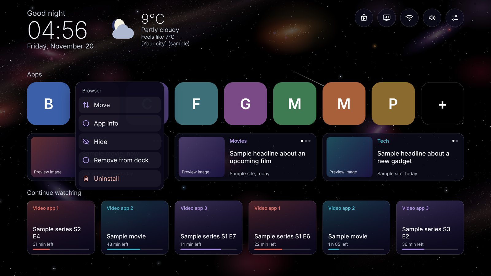
*Press and hold an app for its menu*

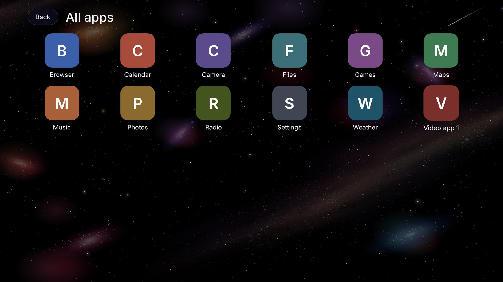
*All apps*

The dock shows the apps you want, in your order. The last tile, **+**, opens **All apps**.

- **OK** opens an app.
- **Press and hold** an app for its menu:
  - **Move**: use Left and Right to move it, then press OK to place it
  - **App info**: Android's own page for that app
  - **Remove from dock**: it goes to All apps; add it back from All apps with **Add to dock**
  - **Hide**: hides it from the dock and All apps; undo in Settings, Hidden apps
  - **Uninstall**: Android asks you to confirm
- **Icon look** (only some apps; many keep their original look): each press changes the tile and the menu stays open so you can compare. How well Black and White work depends on the app's own icon; if a look does not suit an app, go back to Original. **Original** is the app's own icon, **Black** puts the logo on black, **White** puts the logo in the app's colour on a light tile. Icons that are one flat picture, without a separate logo, keep their original look when you pick White. The Play Store cycles **Colors**, **Black**, **White**.
- In **All apps**, press and hold an app to add it to or remove it from the dock, open its App info, and so on.

The dock has no app names under the tiles, on purpose.

## Home rows: show, hide, order

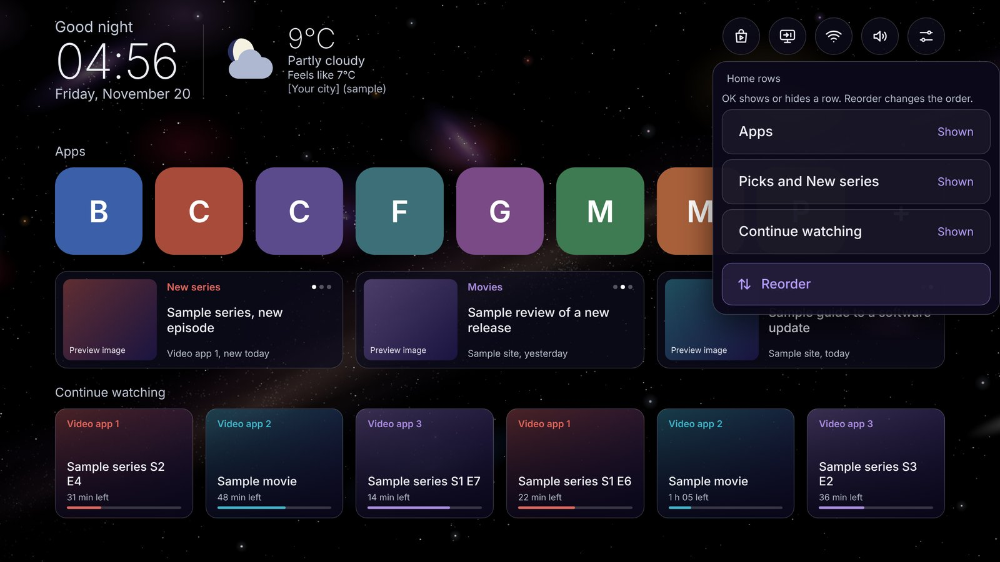
*Settings, Home rows*

The three rows (Apps, Picks and New series, Continue watching) can each be shown or hidden, and put in any order. Open **Settings**, then **Home rows**. The home screen behind the list updates as you go.

- **Show or hide:** press OK on a row. It switches between *Shown* and *Hidden*. A hidden row takes no space and the others move up. It comes back from the same list.
- **Reorder:** choose **Reorder**. Press OK on a row to pick it up (it says *Moving*), press Up or Down to move it, press OK to drop it. Pick up another one if you like, then choose **Done** (the check mark). Back also returns to the list.

The greeting, clock, date and weather stay at the top.

## Picks and New series

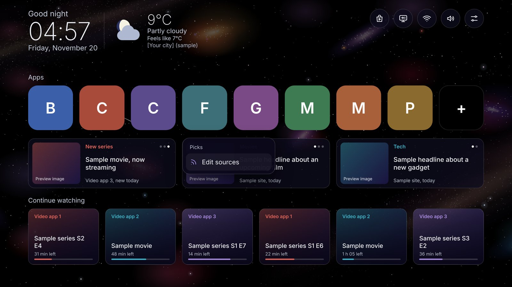
*Press and hold a card for Refresh and Edit sources*

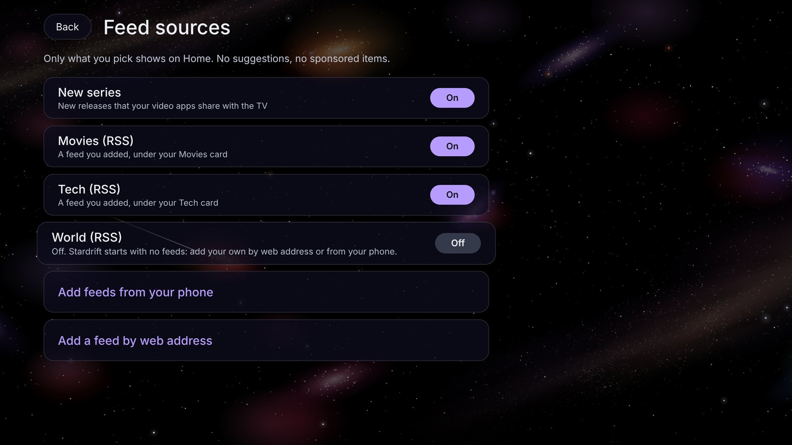
*Edit sources: switch feeds on or off, add from your phone or by web address*

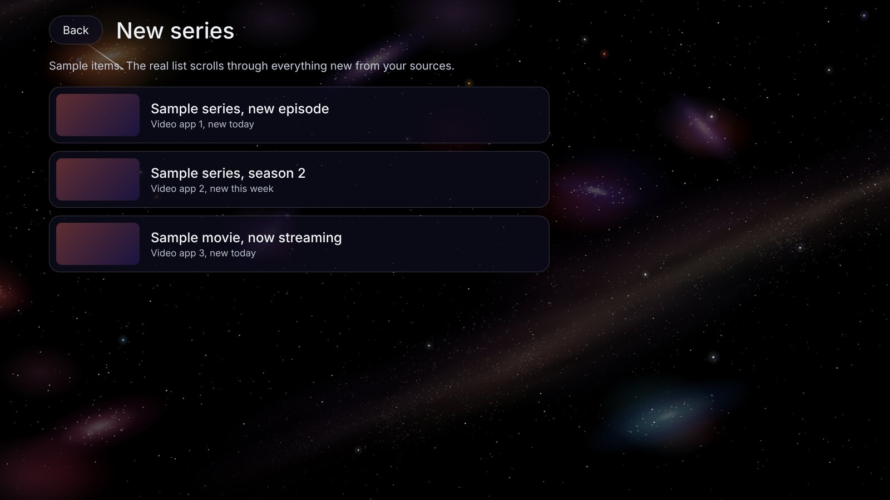
*OK on a card opens the full list for that category*

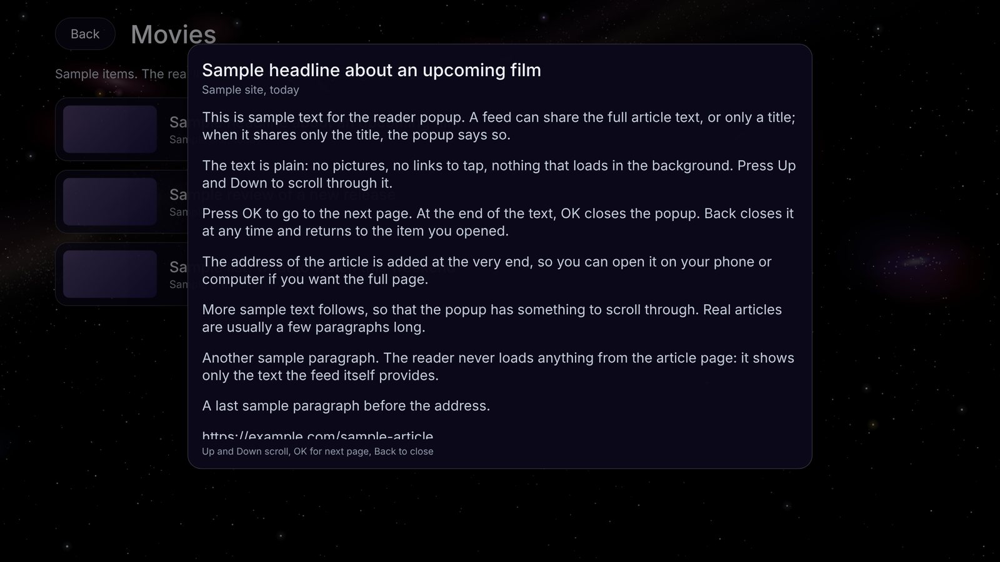
*An item opens in the reader popup: text only. Up and Down scroll, OK for the next page, Back to close*

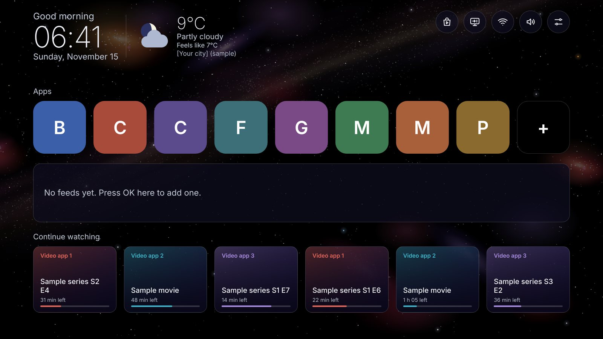
*The first start has no feeds: press OK on the card to add one*

The row under the dock has one card per category. **Stardrift starts with no feeds**: you choose what shows here. Until you add something, the row shows a card that says so; press OK on it to add your first feed. A card only shows when at least one source in it is switched on. Each card steps through its latest headlines by itself (the dots show how many), with a preview image when the feed has one.

- **OK** on a card opens the full list for that category. **OK** on an item opens a reader popup with the article text from the feed (when a feed only shares a title, the popup says so). Up and Down scroll, OK for the next page, Back to close.
- **Press and hold** a card for **Refresh** and **Edit sources**.
- **Edit sources** lists the feeds. OK switches a feed on or off. A feed you added yourself can be removed with press and hold. You can add a feed by web address, or from your phone (see below).
- **Your own cards:** in **Edit sources**, **Add a card** makes a card with a name you choose (for example *Movies*). Up to four cards fit on Home. When you add a feed by web address or from your phone, you pick which card it goes under, or name a new one.
- **Move a feed:** press and hold a feed in **Edit sources**, **Move to another card**.
- **Add an app to a card:** **Add an app to a card** shows new releases that one of your streaming apps shares with the TV, under the card you pick.
- **Rename or remove a card you made:** press and hold the card. Removing it also removes the feeds you added under it.
- **New series** is not a web feed: it shows new releases that the streaming apps you choose share with the TV. Press and hold it, **Choose apps**. The card stays hidden until your apps share something.

Only what you switch on shows up. There are no suggestions and nothing sponsored.

### Finding an RSS feed

An **RSS feed** is a web address that lists a site's newest posts (title, link, often a picture) in a form apps can read. It is how Stardrift shows headlines without opening the website.

- **Look for it on the site.** Many sites have an RSS, Feed or Subscribe link, often at the bottom of the page.
- **Try the usual addresses.** Add `/feed`, `/rss` or `/rss.xml` to the end of the site's address. Not every site has one.
- **Check it before you add it.** Open the address in a browser. A working feed shows a list of recent posts as plain text or a simple page, not the normal website.
- **Ask your AI assistant.** For example: "Find the RSS feed address for the site or topic I care about, and check that it opens and has recent posts." AI can get this wrong or invent an address, so always open it in a browser first.
- Then use **Edit sources**, add it by web address (or from your phone, see below), and pick the card it goes under.
- **Add several at once.** Ask your AI assistant for a list of feed addresses on the topics you like, one per line, and check each one opens. Then open **Add from your phone** on the TV, paste the whole list and the PIN shown on the TV.

If your network filters DNS, also allow the feed's host and the host of its images (see the README).

## Continue watching

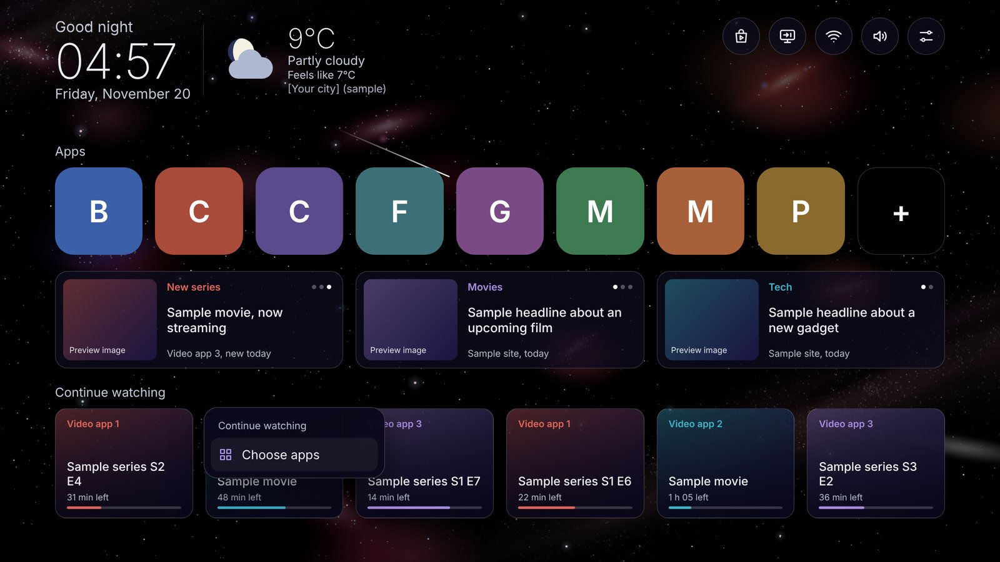
*Press and hold the row for Refresh or Choose apps*

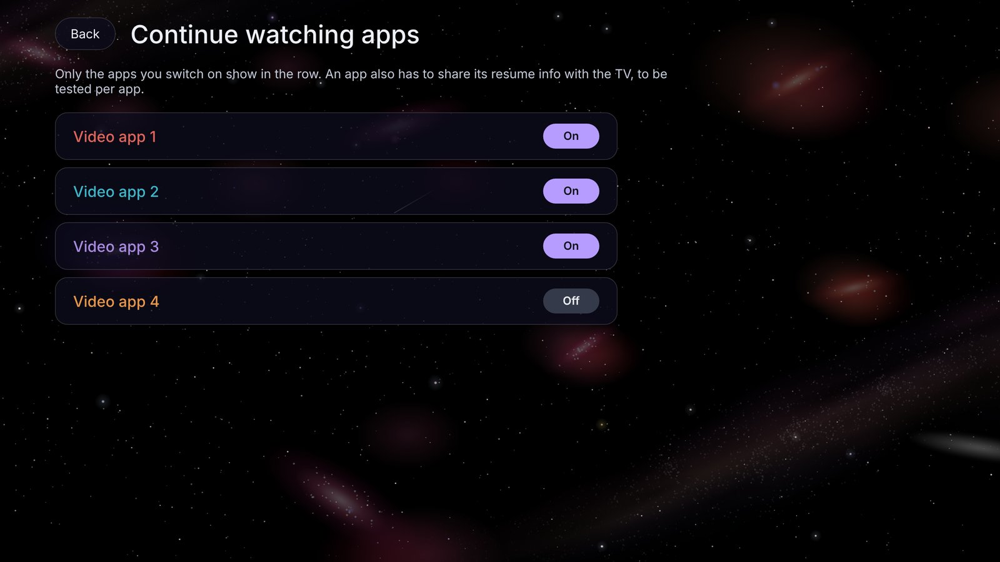
*Choose apps: only the apps you switch on show in the row*

This row shows what you were in the middle of.

- It reads the Google TV *Continue watching* rows that your streaming apps share. The first time, the TV asks for permission to read them; accept it, otherwise the row can only show recently opened apps.
- If none of your apps share anything, the row is labelled **Recently opened** and shows the apps you opened last.
- **Press and hold** the row: **Refresh** or **Choose apps**. Only the apps you switch on in Choose apps show in the row.

## Top icons

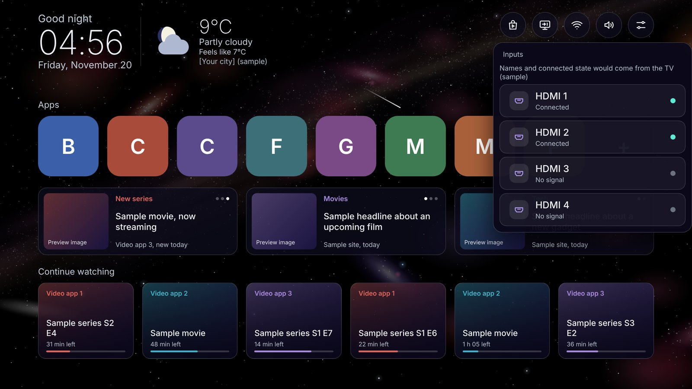
*Inputs*

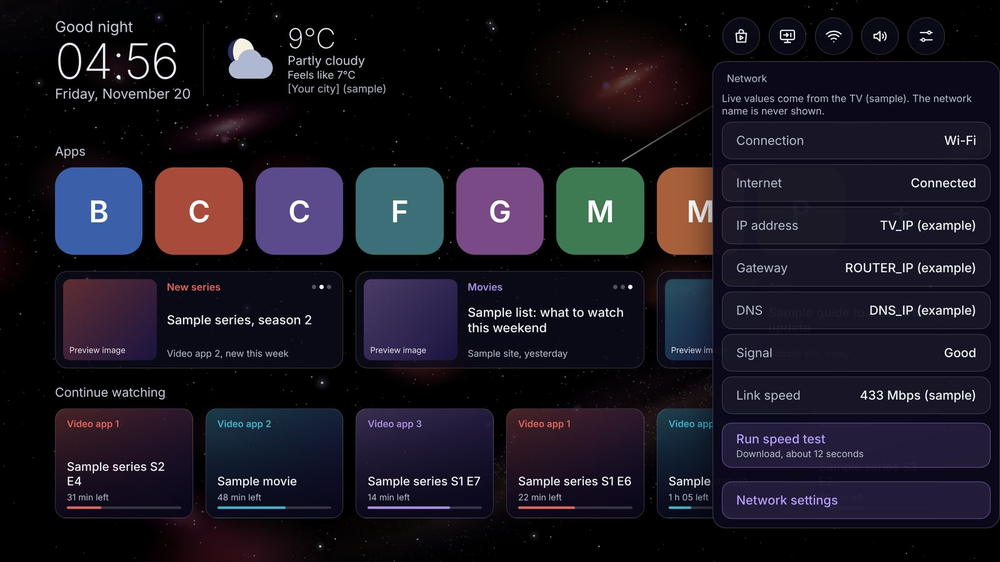
*Network*

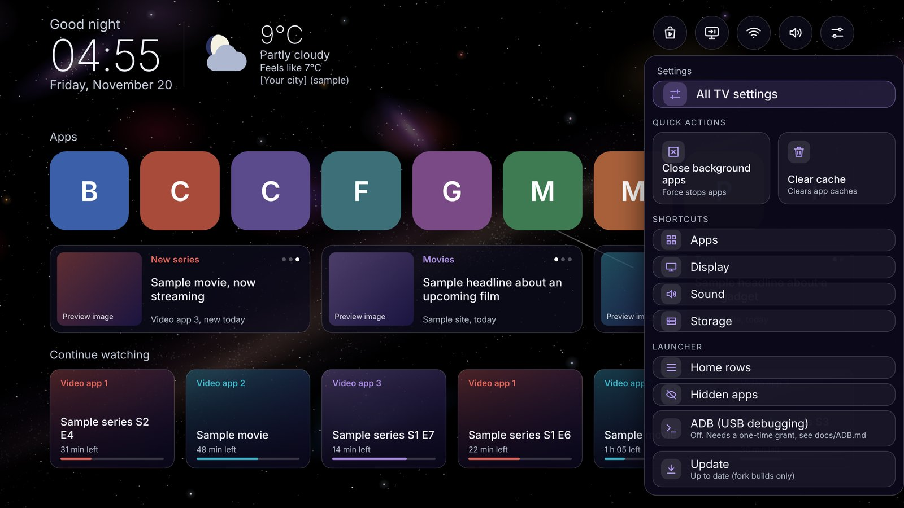
*Settings*

The round icons at the top right open popups on the right side of the screen:

| Icon | What it does |
|---|---|
| Play Store | Opens the Google Play Store |
| Inputs | Lists the inputs your TV shares with apps (HDMI and others) so you can switch. If your TV shares none, it says so: use the INPUT button on the remote |
| Network | Connection status, signal, IP address, gateway, link speed, and a **download speed test** (about 12 seconds). The network name is never shown |
| Speaker | [Sound](#sound): music and effects |
| Settings | Quick actions, shortcuts and launcher settings (below) |

**Settings** contains:

- **All TV settings**: opens Android's own settings
- **Quick actions**: **Close background apps** (stops the apps you installed that are running; apps that came with the TV are left alone) and **Clear cache** (clears the cache of every app; it says how much it freed). Both use the TV's own debugging service, so they need the one-time permission in [ADB.md](ADB.md#optional-switches-in-settings); the first time the TV asks **Allow USB debugging?**: tick *Always allow*. Without that they fall back to a weaker method and tell you so
- **Shortcuts**: Apps, Display, Sound, Storage (straight to those Android pages)
- **Launcher**: **Home rows** (show, hide and reorder the rows) and **Hidden apps** (to show an app again)
- **ADB (USB debugging)** and, on TVs that have their own Quick Settings bar, **Quick Settings key**: switches that need the one-time permission in [ADB.md](ADB.md#optional-switches-in-settings)
- **Update**: only in builds made by GitHub Actions in your own fork, see [BUILD.md](BUILD.md#update-from-the-tv-update-button)

## Sound

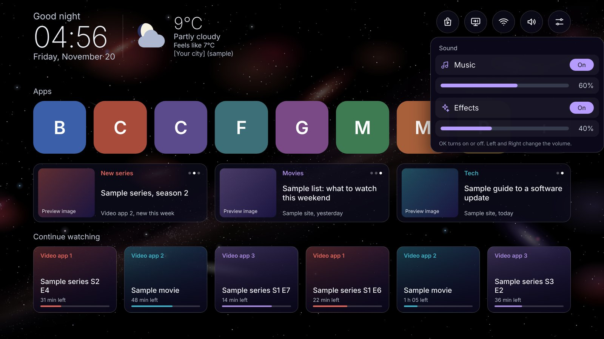
*Music and Effects, each with its own volume*

The speaker icon opens two switches, each with its own volume:

- **Music:** a soft ambient song on the home screen. It fades in and out, loops without a gap, and stays silent when another app plays audio.
- **Effects:** soft interface sounds for moving, selecting, going back, opening and closing, and a small bump at the edges.

On a switch, **OK** turns it on or off and **Left and Right** change the volume.

## Screensaver

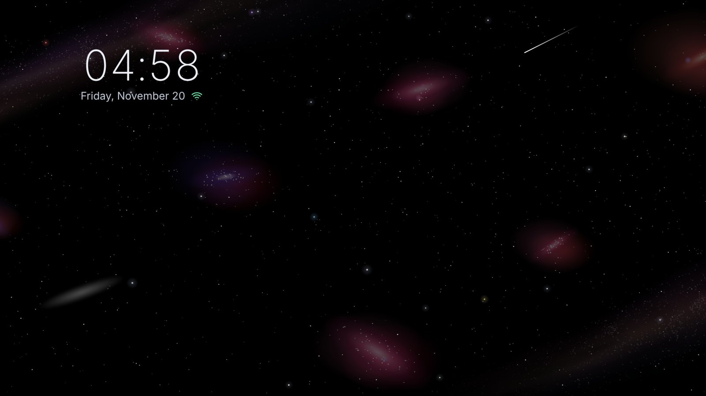
*The Stardrift screensaver: the same sky, a 24 hour clock, the date and a Wi-Fi icon*

Stardrift includes its own screensaver, **Stardrift**: the same sky, a 24 hour clock, the date and a Wi-Fi icon, all drifting slowly. It plays the ambient song when Music is on.

Choose it in the TV's own settings, under the screensaver (Ambient mode) options. On many Google TVs: **Settings**, **System**, **Ambient mode**. The name and place can differ by TV.

## Adding feeds from your phone

Typing web addresses with a remote is slow, so you can do it from a phone:

1. On the TV open **Edit sources**, then **Add from phone**.
2. The TV shows a web address and a **PIN**. On your phone, on the **same Wi-Fi**, open that address.
3. Type the PIN shown on the TV, then paste up to 20 feed addresses at a time.
4. Each address is checked; the ones that are not working feeds are reported.

The page only runs while that screen is open on the TV. Close the screen and it is gone. After too many wrong PINs, close the screen on the TV and open it again.

## Privacy and network

- No accounts, no ads, no analytics.
- The launcher contacts only the weather service ([Open-Meteo](https://open-meteo.com/)) and the feeds and images you switched on.
- The home network page for adding feeds is protected by a PIN and only open while its screen is shown.

If your network filters DNS (an ad blocker, for example), allow the hosts listed in the [README](../README.md#network-dns-filters). Symptoms of a blocked host: *Weather unavailable* (weather host), *Nothing to show yet. Check the internet connection.* (feeds), or pictures that stay empty.

After a TV restart the network can come up late; the launcher retries feeds, pictures and Continue watching by itself, and reloads when the network comes up.

## Updating and removing

- **Update:** build a new APK and install it with the same command as the first time (`install -r`). See [BUILD.md](BUILD.md) and [ADB.md](ADB.md). Settings stay as long as the APK is signed with the same key.
- **Remove:** `adb -s ADDRESS uninstall dev.tvlauncher.home`, or uninstall **Stardrift** from the TV's Apps settings. The original Home screen comes back.

## Problems

| Problem | Try |
|---|---|
| Weather says *Choose your city* | Press OK on it and search for your city |
| *Weather unavailable* | Check the TV's internet; allow `api.open-meteo.com` in your DNS filter |
| News row empty | Press and hold the row, **Refresh**; check **Edit sources** has feeds on; check the DNS filter |
| Continue watching empty or only recent apps | Accept the permission when asked; apps decide themselves whether they share their rows; use **Choose apps** |
| No sound | Open the speaker icon: Music and Effects must be **On**; the music stays silent while another app plays audio |
| A tile looks wrong | Press and hold it, **Hide** it or **Remove from dock**, and add it back from All apps |
| Home button opens another home screen | See [HOME.md](HOME.md): who is Home, and turning the stock launcher off safely |
| A remote button does nothing | See [HOME.md](HOME.md), "A remote button does nothing" |
| You want to know what a permission or prompt allows | See [PERMISSIONS.md](PERMISSIONS.md) |
| The TV is slow or has apps you never use | See [TV-TUNING.md](TV-TUNING.md): what to look at, what starts at boot, ads and telemetry |
| Update refuses to install | The new APK was signed with a different key: see the `INSTALL_FAILED_UPDATE_INCOMPATIBLE` row in [ADB.md](ADB.md) |

Still stuck? There is no support and issues are turned off. Fork the repository and fix it, or ask your AI assistant to help (it should start from [AGENTS.md](../AGENTS.md)).
